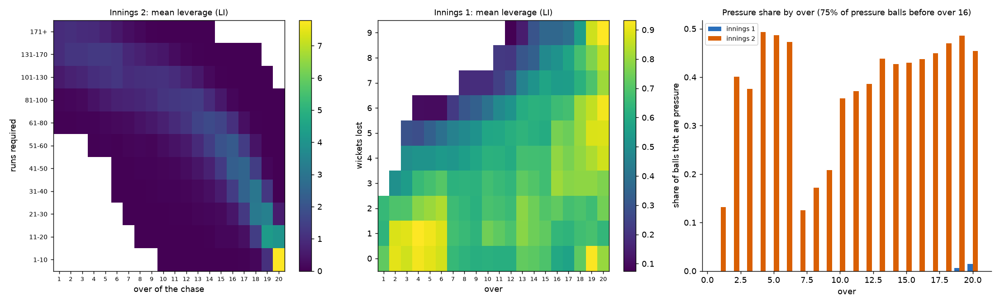
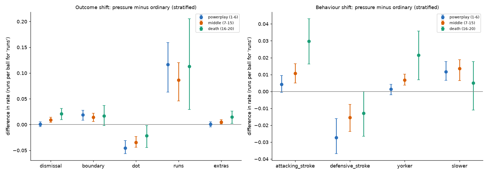
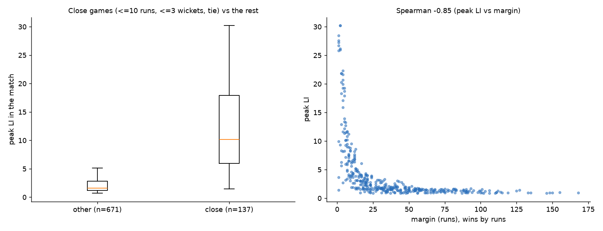
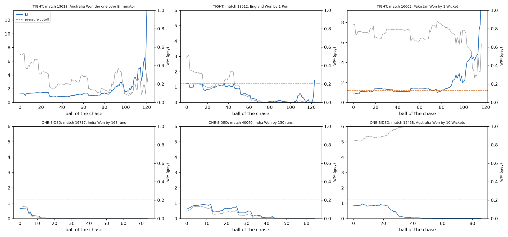
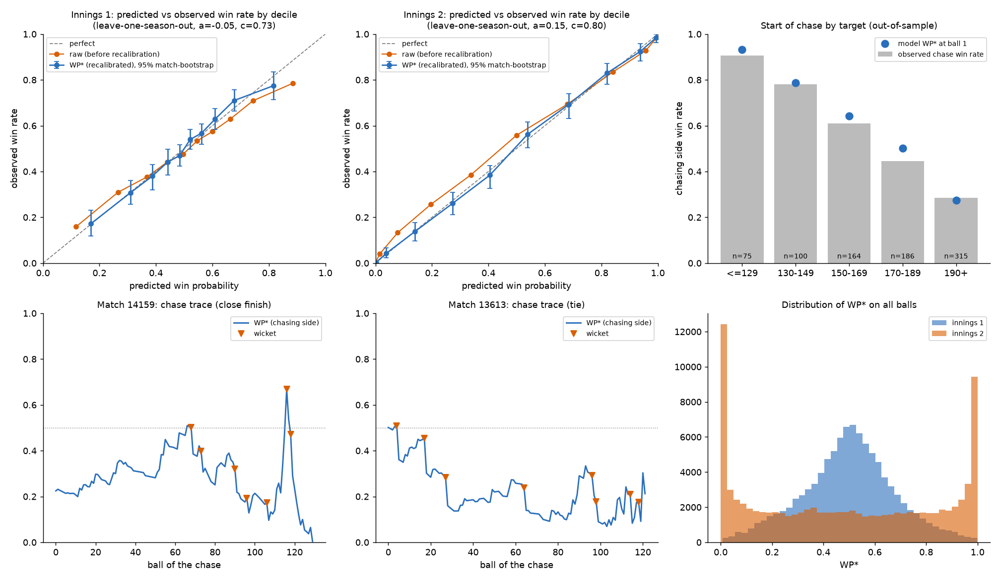
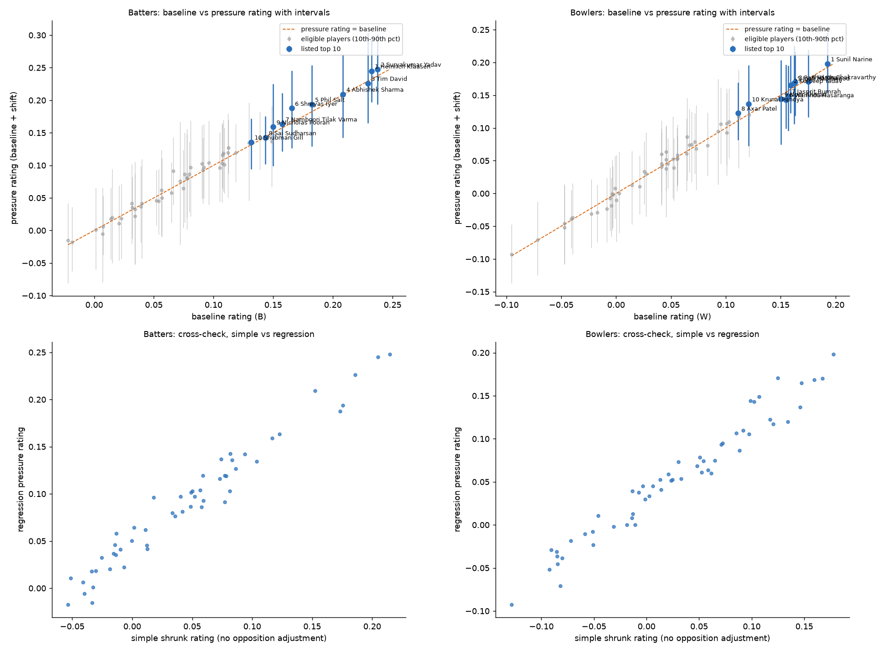

# Who delivers when it matters
### SupeRR Selector Season 2, Round 1: how we rated batters and bowlers under pressure

## 1. The answer

> **The ratings measure proven quality in live, high-leverage situations. A separate clutch trait is not reliably measurable in this data** (pressure-shift split-half reliability 0.13 for batters and 0.15 for bowlers).

**Top 10 batters**

|   # | Name                 | Teams                                 |   Pressure rating |   Floor |   P(top 10) |
|----:|:---------------------|:--------------------------------------|------------------:|--------:|------------:|
|   1 | Heinrich Klaasen     | Sunrisers Hyderabad / South Africa    |             0.245 |   0.197 |       0.993 |
|   2 | Suryakumar Yadav     | Mumbai Indians / India                |             0.248 |   0.194 |       0.990 |
|   3 | Tim David            | Mumbai Indians / Australia            |             0.226 |   0.165 |       0.907 |
|   4 | Abhishek Sharma      | Sunrisers Hyderabad / India           |             0.209 |   0.143 |       0.850 |
|   5 | Phil Salt            | Royal Challengers Bengaluru / England |             0.194 |   0.129 |       0.763 |
|   6 | Shreyas Iyer         | Punjab Kings / India                  |             0.188 |   0.126 |       0.743 |
|   7 | Namboori Tilak Varma | Mumbai Indians / India                |             0.164 |   0.121 |       0.587 |
|   8 | Sai Sudharsan        | Gujarat Titans                        |             0.142 |   0.102 |       0.283 |
|   9 | Nicholas Pooran      | Lucknow Super Giants / West Indies    |             0.159 |   0.099 |       0.563 |
|  10 | Shubman Gill         | Gujarat Titans / India                |             0.136 |   0.094 |       0.247 |

**Top 10 bowlers**

|   # | Name               | Teams                                   |   Pressure rating |   Floor |   P(top 10) |
|----:|:-------------------|:----------------------------------------|------------------:|--------:|------------:|
|   1 | Sunil Narine       | Kolkata Knight Riders                   |             0.198 |   0.153 |       0.983 |
|   2 | Kuldeep Yadav      | Delhi Capitals / India                  |             0.165 |   0.123 |       0.847 |
|   3 | Rashid Khan        | Gujarat Titans / Afghanistan            |             0.170 |   0.119 |       0.840 |
|   4 | Varun Chakravarthy | Kolkata Knight Riders / India           |             0.171 |   0.116 |       0.800 |
|   5 | Josh Hazlewood     | Royal Challengers Bengaluru / Australia |             0.169 |   0.106 |       0.780 |
|   6 | Wanindu Hasaranga  | Royal Challengers Bengaluru / Sri Lanka |             0.143 |   0.099 |       0.683 |
|   7 | Jasprit Bumrah     | Mumbai Indians / India                  |             0.149 |   0.095 |       0.670 |
|   8 | Axar Patel         | Delhi Capitals / India                  |             0.123 |   0.082 |       0.390 |
|   9 | Noor Ahmad         | Chennai Super Kings / Afghanistan       |             0.144 |   0.074 |       0.540 |
|  10 | Krunal Pandya      | Lucknow Super Giants                    |             0.137 |   0.072 |       0.537 |

*Pressure rating = a player's baseline plus his pressure shift, per ball, in units of the expected swing in win probability (higher is better; 0 is an average player in the same situations). Floor = the 10th percentile of the rating across 300 resamples of whole matches; players are ranked on it. P(top 10) = share of resamples in which the player finishes in the top 10 of the eligible pool.*

**The method in five lines**

1. Every ball of both innings gets a win probability from an exact model of the next ball (ten outcome classes, solved by backward induction over match states and recalibrated on held-out seasons: slope 0.73 in innings 1, 0.80 in innings 2).
2. **Pressure is leverage**: how far the next ball is expected to move the win probability. A pressure ball is in the top 20% of live balls (leverage of at least 1.21 against an average live ball of 1).
3. Each ball is valued by the actual change in win probability minus the average change in the same situation, divided by the expected swing, and split between batter and bowler.
4. One ridge regression per role gives each player a **baseline** and a **pressure shift**, adjusting for opposition quality; the penalties are chosen by cross-validation with whole matches held out.
5. Players are ranked by the **floor** of their pressure rating among eligible, active players, after removing anyone whose pressure shift is reliably negative.

**Sample.** 728 matches (353 IPL, 375 full-member T20I), 156,062 live balls of which 31,263 are pressure balls. 53 batters and 56 bowlers meet the eligibility rule (120 pressure balls over at least 15 matches); 53 and 55 were also active in 2025 or 2026.

**Reliability in one line.** The pressure rating is repeatable across random halves of the matches (split-half 0.54 batters, 0.66 bowlers), but that repeatability comes from general quality: the baseline alone scores 0.53 and 0.66. Section 8 gives every reliability number, including a season-to-season correlation of 0.05 for batters.

## 2. How we define pressure

**In plain words.** A ball is high-pressure when what happens on it can swing the result a lot. For every ball we ask the model for the chance of each outcome (dot, 1, 2, 3, 4, 6, wicket, and three kinds of wide or no-ball), work out the win probability after each, and take the expected absolute change. Divided by the average over live balls, this is the leverage index LI. A ball is **live** when the win probability is between 0.02 and 0.98; decided balls are removed from both the pressure set and every baseline. A **pressure ball** has LI at or above the 80th percentile of live balls pooled across both innings (LI of 1.21; median live ball 0.83, 95th percentile 2.00).

`swing(s) = sum over outcomes o of p(o | s) x | WP*(after o) - WP*(s) |        LI(s) = swing(s) / mean swing over live balls`

**Why this definition.** It uses every factor the brief lists (required rate, wickets in hand, balls left, stage of the innings, closeness) through their measured effect on the result, with no hand-picked weights. It uses no hindsight: the final margin is never an input. It works in the first innings in the same unit as the chase, where the standard published pressure index is defined for chases only.

**The engine.** The next-ball model is a multinomial logistic regression on over, wickets lost, required-rate band, venue scoring level, competition group and the impact-player rule, fitted on all clean matches. Win probability is solved exactly from it by backward induction, then recalibrated with two parameters fitted on out-of-fold predictions (innings 1: a = -0.047, c = 0.733; innings 2: a = 0.153, c = 0.804). A slope below 1 is the known over-confidence of exact models. The chase surface is projected to be monotone (win probability cannot rise when a wicket falls) because the raw surface was noisy in thinly observed late-chase states.

**Where pressure lives.**

*Figure: Mean leverage by runs required and over of the chase (left), by wickets lost and over in the first innings (centre), and the share of balls that are pressure balls by over (right).*

Under the pooled cutoff, pressure is mostly a live chase: innings 1 has 98 pressure balls (0.1% of its balls) against 37.2% of innings-2 balls (47.7% of live ones), and 75.4% of all pressure balls fall before over 16. We report this as it is, and the sensitivity grid includes a variant that sets the cutoff within each innings.

**Agreement with simpler definitions.** Against the published Bhattacharjee-Lemmer pressure index (chases only; its resources-used term is replaced by one derived from our own scoring model because the Duckworth-Lewis table is not in the data), the rank correlation with LI on live chase balls is 0.33: the two agree on direction but are far from identical. A common rule of thumb (last five overs with a required rate of 8 to 15, and so on) marks 92.6% of the chase balls it covers as pressure, but covers only 16.4% of the chase pressure balls.

## 3. Proof that it captures pressure

**Pressure balls behave differently from ordinary balls in the same phase.** We compare live pressure balls with live ordinary balls inside strata of innings, phase and wickets band, and weight by the pressure balls in each stratum. Intervals come from 300 resamples of whole matches. Differences are in percentage points (runs per ball for "runs"); `*` marks an interval that excludes zero.

| Phase           | dismissal          | boundary           | dot                | runs                     |
|:----------------|:-------------------|:-------------------|:-------------------|:-------------------------|
| powerplay (1-6) | +0.1 [-0.4, +0.6]  | +1.9 [+0.8, +2.8]* | -4.5 [-5.6, -3.1]* | +0.117 [+0.063, +0.159]* |
| middle (7-15)   | +0.9 [+0.5, +1.4]* | +1.4 [+0.6, +2.2]* | -3.5 [-4.4, -2.3]* | +0.086 [+0.046, +0.120]* |
| death (16-20)   | +2.1 [+1.0, +3.1]* | +1.7 [-0.2, +3.7]  | -2.2 [-4.5, -0.2]* | +0.113 [+0.029, +0.205]* |

The pre-declared gate (dismissal or boundary rate differs in at least two of three phases) is passed in all three. Both sides also change what they attempt, not only what results:

| Phase           | attacking stroke   | defensive stroke   | yorker             | slower             |
|:----------------|:-------------------|:-------------------|:-------------------|:-------------------|
| powerplay (1-6) | +0.4 [-0.1, +0.9]  | -2.7 [-3.7, -1.6]* | +0.1 [-0.2, +0.4]  | +1.2 [+0.7, +1.8]* |
| middle (7-15)   | +1.1 [+0.5, +1.7]* | -1.5 [-2.4, -0.8]* | +0.7 [+0.4, +1.0]* | +1.4 [+0.6, +1.9]* |
| death (16-20)   | +3.0 [+1.6, +4.3]* | -1.3 [-2.6, -0.0]* | +2.2 [+0.7, +3.6]* | +0.5 [-1.1, +1.8]  |

Batters play fewer defensive and more attacking strokes; bowlers reach for yorkers and slower balls.

*Figure: Pressure minus ordinary rates by phase with 95% match-bootstrap intervals: outcomes (left) and behaviour (right).*

**Pressure concentrates in games that finished tight, although the margin is never an input.** 137 of 808 clean matches finished within 10 runs, 3 wickets or a tie. Their median peak leverage is 10.1 against 1.6 for the rest, and across matches won by runs the rank correlation between peak leverage and margin is -0.853 (n = 395).

*Figure: Peak leverage in close games against the rest (left) and against the winning margin (right).*

*Figure: Leverage (blue) and win probability (grey) through three tight finishes (top) and three one-sided chases (bottom).*

**The win probabilities behind the index are honest.** On leave-one-season-out predictions the largest gap between predicted and observed win rate in any decile is 4.2 points in innings 1 and 2.3 in innings 2 (limit 5). The Brier score beats a one-feature logistic baseline in both innings (0.219 against 0.229; 0.127 against 0.149), and the next-ball model reproduces observed outcome frequencies to within 0.7 points in every well-populated cell. Note that the 95% bootstrap intervals on the decile gaps are about plus or minus 5 points, so the gate shows no evidence of miscalibration larger than that, not calibration to a finer tolerance.

*Figure: Predicted against observed win rate by decile, leave-one-season-out (top left and centre); start of chase by target (top right); two chase traces; distribution of win probability.*

## 4. How performance is measured

**Value of a ball.** For each ball, dWP is the change in the batting side's win probability. We subtract the average change among balls in the same state bin (innings, over band, wickets band, leverage band), so a player is compared with what a typical player does in the identical situation, and divide by the ball's expected swing so a six in the last over does not drown out everything else.

**Who gets the credit.** Runs off the bat go to the striker and are charged to the bowler; wides are charged to the bowler only; no-balls charge the bowler the bat runs and the penalty run; byes and leg-byes count as dot balls for both; wickets are charged to the dismissed batter (including non-strikers run out, who get their own row) and credited to the bowler for bowled, caught, lbw, hit wicket and stumpings; run-outs and obstructing the field are not credited to the bowler; retire-outs are charged to nobody.

**The rating model.** Two ridge regressions of the same form, one on balls faced and one on balls bowled:

`batting:  v = context + B_i + P x C_i - (W_j + P x K_j)        bowling:  v = context + W_j + P x K_j - (B_i + P x C_i)`

`i` is the batter, `j` the bowler, `P` is 1 on pressure balls, `B` and `W` are baselines, `C` and `K` are pressure shifts, and context is fixed effects for innings, phase and pressure plus a competition-group term. The opposing players' terms are what adjust for opposition quality. The two penalties (baseline 300, shift 3000, so the shift is shrunk 10 times harder) were chosen by 5-fold cross-validation with whole matches held out. The fit uses 150,307 batter rows and 156,062 bowler rows from live balls in the rating sample.

The ratings track conventional statistics sensibly: among eligible batters the rank correlation between baseline and strike rate is 0.708 (n = 53), and among eligible bowlers between baseline and economy it is -0.795 (n = 56). For each player we also report plain-cricket companions on pressure and ordinary balls: strike rate, runs index (100 times actual over expected bat runs), dismissal ratio (actual over expected), economy, economy index (100 times expected over actual runs conceded), wicket ratio, wins added per 100 pressure balls, and the delivery rate (share of matches with six or more pressure balls in which his total value was positive).

## 5. Fair comparisons

- **Which matches rate players.** 728 IPL and full-member T20I matches without rain or truncation flags, including 7 tied matches. Associate and A-team matches help fit the scoring model but do not rate players. 200,999 raw rows from 867 matches were cleaned to 193,076 rows from 808 matches (super overs, no-results, rain-affected and truncated games removed).
- **Eligibility.** At least 120 pressure balls (one full innings of them) over at least 15 matches, fixed in the configuration before any leaderboard was viewed: 53 batters and 56 bowlers qualify. Players must also have appeared in 2025 or 2026, since the lists inform the next auction. The unfiltered list is in the appendix files.
- **Small samples.** The ridge penalties shrink a thin pressure record toward the player's baseline and a thin baseline toward average. Across eligible batters the standard deviation of baselines is 0.063 against 0.009 for shifts (bowlers 0.067 and 0.008).
- **Opposition quality.** Runs against a strong attack earn more credit than runs against a weak one because the opposing players' terms are in the same regression. A simple version without any regression (raw pressure means shrunk toward a shrunk baseline) ranks players almost identically (rank correlation 0.97 batters, 0.98 bowlers).
- **IPL and T20I together.** One model rates both, with a competition-group term in the context, so there is one leaderboard. Rating IPL-only or T20I-only is among the variants that change the lists most (section 8).
- **Venue and era.** Venue scoring level and the impact-player rule enter the scoring model, and through it the win probabilities and leverage.
- **Batting role.** Wickets lost is part of the state, and adding a batting-position band to the context leaves the batter list unchanged (top-10 overlap 10 of 10).

## 6. Batters: the evidence

|   # | Name                 |   Pressure balls |   Matches | Strike rate P / O   |   Runs index |   Dismissal ratio |   Delivery rate |   P(top 10) | Rank interval   |
|----:|:---------------------|-----------------:|----------:|:--------------------|-------------:|------------------:|----------------:|------------:|:----------------|
|   1 | Heinrich Klaasen     |              200 |        19 | 187.5 / 164.5       |          128 |              0.74 |            0.89 |        0.99 | 1-6             |
|   2 | Suryakumar Yadav     |              433 |        33 | 172.3 / 163.0       |          121 |              0.77 |            0.74 |        0.99 | 1-6             |
|   3 | Tim David            |              270 |        29 | 183.7 / 172.9       |          127 |              0.98 |            0.58 |        0.91 | 1-10            |
|   4 | Abhishek Sharma      |              385 |        33 | 188.1 / 184.5       |          125 |              1.11 |            0.68 |        0.85 | 2-14            |
|   5 | Phil Salt            |              231 |        19 | 188.3 / 167.0       |          127 |              0.59 |            0.73 |        0.76 | 2-16            |
|   6 | Shreyas Iyer         |              298 |        20 | 172.8 / 148.2       |          124 |              0.52 |            0.75 |        0.74 | 3-17            |
|   7 | Namboori Tilak Varma |              497 |        33 | 146.3 / 144.4       |          107 |              0.55 |            0.62 |        0.59 | 4-18            |
|   8 | Sai Sudharsan        |              312 |        24 | 152.6 / 144.9       |           96 |              0.73 |            0.56 |        0.28 | 8-23            |
|   9 | Nicholas Pooran      |              368 |        33 | 164.9 / 156.1       |          119 |              0.83 |            0.62 |        0.56 | 4-23            |
|  10 | Shubman Gill         |              469 |        36 | 164.4 / 147.5       |          108 |              0.87 |            0.57 |        0.25 | 8-26            |

*Pressure balls and matches count balls faced under pressure. Runs index = 100 x actual / expected bat runs; dismissal ratio = actual / expected dismissals; delivery rate = share of matches (with six or more pressure balls) with positive total value; rank interval = 10th to 90th percentile of rank across resamples.*

- **1. Heinrich Klaasen** (Sunrisers Hyderabad / South Africa): pressure rating 0.245 with a floor of 0.197; on 200 pressure balls in 19 matches he strikes at 187.5 against 164.5 on ordinary live balls, scores 128 runs per 100 expected, is dismissed at 0.74 times the expected rate, and adds win probability in 89% of his matches with six or more pressure balls.
- **2. Suryakumar Yadav** (Mumbai Indians / India): pressure rating 0.248 with a floor of 0.194; on 433 pressure balls in 33 matches he strikes at 172.3 against 163.0 on ordinary live balls, scores 121 runs per 100 expected, is dismissed at 0.77 times the expected rate, and adds win probability in 74% of his matches with six or more pressure balls.
- **3. Tim David** (Mumbai Indians / Australia): pressure rating 0.226 with a floor of 0.165; on 270 pressure balls in 29 matches he strikes at 183.7 against 172.9 on ordinary live balls, scores 127 runs per 100 expected, is dismissed at 0.98 times the expected rate, and adds win probability in 58% of his matches with six or more pressure balls.
- **4. Abhishek Sharma** (Sunrisers Hyderabad / India): pressure rating 0.209 with a floor of 0.143; on 385 pressure balls in 33 matches he strikes at 188.1 against 184.5 on ordinary live balls, scores 125 runs per 100 expected, is dismissed at 1.11 times the expected rate, and adds win probability in 68% of his matches with six or more pressure balls.
- **5. Phil Salt** (Royal Challengers Bengaluru / England): pressure rating 0.194 with a floor of 0.129; on 231 pressure balls in 19 matches he strikes at 188.3 against 167.0 on ordinary live balls, scores 127 runs per 100 expected, is dismissed at 0.59 times the expected rate, and adds win probability in 73% of his matches with six or more pressure balls.
- **6. Shreyas Iyer** (Punjab Kings / India): pressure rating 0.188 with a floor of 0.126; on 298 pressure balls in 20 matches he strikes at 172.8 against 148.2 on ordinary live balls, scores 124 runs per 100 expected, is dismissed at 0.52 times the expected rate, and adds win probability in 75% of his matches with six or more pressure balls.
- **7. Namboori Tilak Varma** (Mumbai Indians / India): pressure rating 0.164 with a floor of 0.121; on 497 pressure balls in 33 matches he strikes at 146.3 against 144.4 on ordinary live balls, scores 107 runs per 100 expected, is dismissed at 0.55 times the expected rate, and adds win probability in 62% of his matches with six or more pressure balls.
- **8. Sai Sudharsan** (Gujarat Titans): pressure rating 0.142 with a floor of 0.102; on 312 pressure balls in 24 matches he strikes at 152.6 against 144.9 on ordinary live balls, scores 96 runs per 100 expected, is dismissed at 0.73 times the expected rate, and adds win probability in 56% of his matches with six or more pressure balls.
- **9. Nicholas Pooran** (Lucknow Super Giants / West Indies): pressure rating 0.159 with a floor of 0.099; on 368 pressure balls in 33 matches he strikes at 164.9 against 156.1 on ordinary live balls, scores 119 runs per 100 expected, is dismissed at 0.83 times the expected rate, and adds win probability in 62% of his matches with six or more pressure balls.
- **10. Shubman Gill** (Gujarat Titans / India): pressure rating 0.136 with a floor of 0.094; on 469 pressure balls in 36 matches he strikes at 164.4 against 147.5 on ordinary live balls, scores 108 runs per 100 expected, is dismissed at 0.87 times the expected rate, and adds win probability in 57% of his matches with six or more pressure balls.

*Figure: Baseline against pressure rating with 10th to 90th percentile intervals (top), and the simple cross-check against the regression rating (bottom). Pressure ratings sit almost on the baseline line: the shift adds little.*

## 7. Bowlers: the evidence

|   # | Name               |   Pressure balls |   Matches | Economy P / O   |   Economy index |   Wicket ratio |   Delivery rate |   P(top 10) | Rank interval   |
|----:|:-------------------|-----------------:|----------:|:----------------|----------------:|---------------:|----------------:|------------:|:----------------|
|   1 | Sunil Narine       |              300 |        23 | 7.28 / 6.56     |             121 |           1.23 |            0.59 |        0.98 | 1-7             |
|   2 | Kuldeep Yadav      |              299 |        20 | 8.10 / 7.77     |             117 |           1.13 |            0.74 |        0.85 | 1-12            |
|   3 | Rashid Khan        |              439 |        33 | 6.67 / 7.44     |             128 |           1.10 |            0.73 |        0.84 | 1-12            |
|   4 | Varun Chakravarthy |              373 |        31 | 8.77 / 7.93     |             100 |           1.34 |            0.58 |        0.80 | 1-13            |
|   5 | Josh Hazlewood     |              352 |        25 | 8.36 / 8.03     |             111 |           1.55 |            0.59 |        0.78 | 1-15            |
|   6 | Wanindu Hasaranga  |              364 |        26 | 8.89 / 7.44     |              95 |           1.34 |            0.50 |        0.68 | 3-17            |
|   7 | Jasprit Bumrah     |              318 |        27 | 7.84 / 6.97     |             117 |           0.59 |            0.41 |        0.67 | 3-17            |
|   8 | Axar Patel         |              386 |        35 | 8.36 / 7.71     |             107 |           1.19 |            0.61 |        0.39 | 5-20            |
|   9 | Noor Ahmad         |              207 |        16 | 9.66 / 7.74     |              92 |           1.39 |            0.31 |        0.54 | 2-23            |
|  10 | Krunal Pandya      |              247 |        18 | 6.60 / 8.01     |             131 |           1.52 |            0.76 |        0.54 | 2-22            |

*Economy index = 100 x expected / actual runs conceded; wicket ratio = actual / expected bowler-credited wickets. On pressure balls a wicket is worth 8.1 runs on average in these states.*

**Why each bowler ranks where he does** (net runs = (actual minus expected wickets) x the model's run value of a wicket, minus (actual minus expected runs conceded); the interval is a match bootstrap):

- **1. Sunil Narine** (Kolkata Knight Riders): on 300 pressure balls he took 18 wickets against 14.6 expected (+28 runs of value) and conceded 359 runs against 435 expected (+76 runs), a net +103 runs (10th to 90th percentile +37 to +164); wicket-taking adds value and run-saving adds value (run-saving is the larger part), which gives a pressure rating of 0.198 and a floor of 0.153.
- **2. Kuldeep Yadav** (Delhi Capitals / India): on 299 pressure balls he took 17 wickets against 15.1 expected (+13 runs of value) and conceded 389 runs against 454 expected (+65 runs), a net +78 runs (10th to 90th percentile +36 to +122); wicket-taking adds value and run-saving adds value (run-saving is the larger part), which gives a pressure rating of 0.165 and a floor of 0.123.
- **3. Rashid Khan** (Gujarat Titans / Afghanistan): on 439 pressure balls he took 24 wickets against 21.9 expected (+15 runs of value) and conceded 481 runs against 617 expected (+136 runs), a net +152 runs (10th to 90th percentile +87 to +215); wicket-taking adds value and run-saving adds value (run-saving is the larger part), which gives a pressure rating of 0.170 and a floor of 0.119.
- **4. Varun Chakravarthy** (Kolkata Knight Riders / India): on 373 pressure balls he took 26 wickets against 19.4 expected (+51 runs of value) and conceded 541 runs against 541 expected (+0 runs), a net +51 runs (10th to 90th percentile -24 to +118); wicket-taking adds value and run-saving is roughly neutral, which gives a pressure rating of 0.171 and a floor of 0.116.
- **5. Josh Hazlewood** (Royal Challengers Bengaluru / Australia): on 352 pressure balls he took 30 wickets against 19.3 expected (+97 runs of value) and conceded 474 runs against 528 expected (+54 runs), a net +151 runs (10th to 90th percentile +56 to +242); wicket-taking adds value and run-saving adds value (wicket-taking is the larger part), which gives a pressure rating of 0.169 and a floor of 0.106.
- **6. Wanindu Hasaranga** (Royal Challengers Bengaluru / Sri Lanka): on 364 pressure balls he took 26 wickets against 19.4 expected (+45 runs of value) and conceded 532 runs against 504 expected (-28 runs), a net +17 runs (10th to 90th percentile -31 to +69); wicket-taking adds value and he concedes more than expected, which gives a pressure rating of 0.143 and a floor of 0.099.
- **7. Jasprit Bumrah** (Mumbai Indians / India): on 318 pressure balls he took 10 wickets against 16.9 expected (-62 runs of value) and conceded 405 runs against 472 expected (+67 runs), a net +5 runs (10th to 90th percentile -68 to +86); his wickets fall short of expectation and run-saving adds value, which gives a pressure rating of 0.149 and a floor of 0.095.
- **8. Axar Patel** (Delhi Capitals / India): on 386 pressure balls he took 24 wickets against 20.2 expected (+31 runs of value) and conceded 532 runs against 571 expected (+39 runs), a net +70 runs (10th to 90th percentile -7 to +155); wicket-taking adds value and run-saving adds value (run-saving is the larger part), which gives a pressure rating of 0.123 and a floor of 0.082.
- **9. Noor Ahmad** (Chennai Super Kings / Afghanistan): on 207 pressure balls he took 14 wickets against 10.1 expected (+26 runs of value) and conceded 309 runs against 283 expected (-26 runs), a net +0 runs (10th to 90th percentile -48 to +49); wicket-taking adds value and he concedes more than expected, which gives a pressure rating of 0.144 and a floor of 0.074.
- **10. Krunal Pandya** (Lucknow Super Giants): on 247 pressure balls he took 17 wickets against 11.2 expected (+47 runs of value) and conceded 266 runs against 348 expected (+82 runs), a net +130 runs (10th to 90th percentile +73 to +188); wicket-taking adds value and run-saving adds value (run-saving is the larger part), which gives a pressure rating of 0.137 and a floor of 0.072.

**Why eight of the ten are spinners.** Eight of the ten listed bowlers are spinners (Sunil Narine, Kuldeep Yadav, Rashid Khan, Varun Chakravarthy, Wanindu Hasaranga, Axar Patel, Noor Ahmad, Krunal Pandya); the two pace bowlers are Josh Hazlewood and Jasprit Bumrah. Exposure does not explain this: spinners bowl 35.0% of pressure balls against 37.2% of all live balls in the rating sample (a ratio of 0.94), so they are not handed more pressure overs than their share of play. Spinners are 20 of the 55 bowlers in the eligible, active pool (36%) but 8 of the 10 on the list. The list therefore over-represents spinners relative to the pool, and because spinners are not over-exposed to pressure, the gap comes from the value they add per pressure ball, not from volume. The data do not say why (pitch conditions, match-ups and captains' choices are not modelled), so this is reported as an observation, not an explanation.

**Sign check.** Every listed batter has a runs index above 100 or a dismissal ratio below 1. For bowlers the check is economy index above 100 **or** wicket ratio above 1 on pressure balls, which all ten pass. This is a post-hoc amendment: the original, economy-only check fails for Wanindu Hasaranga and Noor Ahmad, who rank high on wickets while conceding slightly more than expected. The list that results from the strict economy-only rule is in Appendix A; it replaces those two with Mujeeb Ur Rahman and Bhuvneshwar Kumar.

## 8. Reliability

All numbers below are reported as they came out.

**Split-half reliability** (200 random splits of matches; each half rated with the same penalties and half the eligibility thresholds; Spearman-Brown corrected):

| role    | quantity        |   raw r |   corrected r |   SD over splits |   players (avg) |
|:--------|:----------------|--------:|--------------:|-----------------:|----------------:|
| batters | baseline        |   0.370 |         0.531 |            0.117 |          41.800 |
| batters | pressure rating |   0.374 |         0.536 |            0.117 |          41.800 |
| batters | pressure shift  |   0.082 |         0.130 |            0.206 |          41.800 |
| bowlers | baseline        |   0.499 |         0.662 |            0.074 |          45.200 |
| bowlers | pressure rating |   0.499 |         0.662 |            0.073 |          45.200 |
| bowlers | pressure shift  |   0.091 |         0.149 |            0.184 |          45.200 |

The pressure rating clears the pre-declared 0.40 line for both roles (batters 0.54, bowlers 0.66), so the lists rank on it. The pressure **shift** on its own does not (0.13 and 0.15, below 0.25), and the baseline is as reliable as the pressure rating. The reliability of the rating is therefore the reliability of general quality.

**Season to season** (fit on 2022 to 2024, score 2025 to 2026; bootstrap over players):

| role    |   players |   pressure rating r |   spearman |   CI low |   CI high |   baseline r |   shift r |
|:--------|----------:|--------------------:|-----------:|---------:|----------:|-------------:|----------:|
| batters |        34 |               0.048 |      0.003 |   -0.229 |     0.317 |        0.027 |     0.079 |
| bowlers |        37 |               0.511 |      0.522 |    0.252 |     0.720 |        0.487 |     0.067 |

Bowlers persist (r = 0.51); **batters do not: r = 0.05** (95% interval -0.23 to 0.32, 34 players), and even the batter baseline correlates at only 0.03. With few players in both periods the interval is wide, but there is no evidence of batter persistence across the two periods.

**Does the shift add anything?** Regressing later mean value on pressure balls on the earlier baseline and the earlier shift (per standard deviation):

| role    | term                      |   coefficient |   CI low |   CI high | excludes 0   |   n |
|:--------|:--------------------------|--------------:|---------:|----------:|:-------------|----:|
| batters | earlier baseline (per SD) |         0.009 |   -0.050 |     0.058 | False        |  34 |
| batters | earlier shift (per SD)    |         0.020 |   -0.016 |     0.053 | False        |  34 |
| bowlers | earlier baseline (per SD) |         0.085 |    0.036 |     0.133 | True         |  37 |
| bowlers | earlier shift (per SD)    |         0.011 |   -0.037 |     0.044 | False        |  37 |

The shift coefficient's interval includes zero for both roles: pressure-specific skill is not separable in this data. Only the bowler baseline predicts later pressure value.

**Permutation test** (shuffle the pressure flag within each player 500 times, keeping his count of pressure balls; compare the spread of raw shifts):

| role    |   players |   real_spread |   shuffled_mean |   shuffled_p95 |   p_value | beyond 95th pct   |
|:--------|----------:|--------------:|----------------:|---------------:|----------:|:------------------|
| batters |       217 |         0.270 |           0.244 |          0.270 |     0.062 | False             |
| bowlers |       228 |         0.252 |           0.231 |          0.252 |     0.048 | True              |

Evidence that players differ under pressure is weak: borderline for bowlers (p = 0.048) and not reached for batters (p = 0.062).

**Rank stability.** Every listed player has a probability of finishing in the top 20 of at least 0.76; the lowest probability of a top-10 finish is 0.25. 0 of the 20 are flagged fragile (a player is fragile if he drops out of the top 10 in more than half of the sensitivity variants); the least stable listed player is Shubman Gill, in the top 10 under 7 of 14 variants.

**Sensitivity grid.** Each variant re-rates players with the penalties fixed; overlap is with the main top 10 on the same floor proxy (rating minus 1.28 bootstrap standard deviations), tau is Kendall's rank correlation over the pool. Median overlap is 9 of 10 for batters and 9 for bowlers (the pre-declared target is 7).

| Variant                  |   Batters overlap |   Batters tau |   Bowlers overlap |   Bowlers tau |
|:-------------------------|------------------:|--------------:|------------------:|--------------:|
| IPL_only                 |                 6 |         0.734 |                 8 |         0.638 |
| T20I_only                |                 6 |         0.538 |                 7 |         0.552 |
| benchmark_pressure_index |                10 |         0.948 |                 9 |         0.938 |
| benchmark_rule_of_thumb  |                10 |         0.929 |                 9 |         0.919 |
| cutoff_top10%            |                 9 |         0.964 |                 9 |         0.937 |
| cutoff_top15%            |                 9 |         0.972 |                10 |         0.961 |
| cutoff_top25%            |                 9 |         0.971 |                10 |         0.977 |
| cutoff_top30%            |                 9 |         0.959 |                10 |         0.966 |
| cutoff_within_innings    |                 9 |         0.938 |                 9 |         0.923 |
| lower_tier_included      |                10 |         0.956 |                10 |         0.952 |
| no_cutoff_log_leverage   |                 9 |         0.914 |                 9 |         0.918 |
| position_band_in_context |                10 |         0.983 |                10 |         1.000 |
| recency_2yr_half_life    |                 8 |         0.803 |                 8 |         0.832 |
| winsorised_values_1_99   |                10 |         0.978 |                10 |         0.957 |

The lowest overlap is 6 of 10 (IPL only, batters), from rating on a different slice of the data. Two further comparisons: ranking on the floor of the baseline alone gives 9 of 10 of the main batter list and 10 of 10 of the main bowler list; weighting recent seasons (two-season half-life) keeps 8 of 10 batters (out: Nicholas Pooran, Shubman Gill; in: Ishan Kishan, Virat Kohli). Capping ball values at their 1st and 99th percentiles keeps 10 of 10 for both roles.

## 9. Limitations

- **Pressure is mostly a live chase.** With the pooled cutoff, innings 1 contributes 98 pressure balls, so the ratings are close to ratings of performance in live chases; first-innings pressure is nearly absent by construction.
- **Venue is not in the rating context.** Venue scoring level enters the scoring model (and so win probability and leverage) but the rating regression's context has no venue term, only innings, phase, pressure and competition group.
- **One sensitivity variant was not run.** Win probability without recalibration would need the whole leverage stage rerun and was skipped. The sensitivity grid also uses a floor proxy (rating minus 1.28 bootstrap standard deviations) because the bootstrap is not rerun per variant; the final ranking uses the true bootstrap floor.
- **The bowler sign check was amended after the results were seen** (section 7). The original rule's list is in Appendix A.
- **No separable clutch trait.** The pressure shift is not reliable, batter ratings do not persist season to season (r = 0.05), and the permutation test is borderline. The lists rank proven quality in live, high-leverage situations.
- **Team scores are rebuilt.** Bye, leg-bye and extra-wide runs are not recorded, so scores are rebuilt and partly imputed. Against public scorecards for 15 matches drawn with a fixed seed, the mean error is -1.00 runs and 29 of 30 innings totals are within 5 runs; rebuilt winning margins differ from the stated margin by a median of 0.0 runs (95th percentile 4.0). In that sample first-innings totals are off by +0.0 runs on average and chase totals by -2.0; the backward anchor handles the chase for runs required.
- **Win probability is team-neutral.** It does not know a side's batting depth: out of sample it over-predicts chasing associates by 8.7 points and A-teams by 5.4 points (full-member T20I 2.3, IPL -0.1).
- **Calibration tolerance.** The 5-point decile tolerance is about as wide as its sampling noise (section 3).
- **Fielding, partnerships and role.** A dropped catch helps the batter and hurts the bowler with no correction; non-strikers and partnerships get no credit; captains give the hardest overs and positions to players they trust, so who faces pressure is not random.
- **Tournament pressure is untested.** There is no World Cup in the data and only 31 knockout matches.
- **Small pools.** Only 53 batters and 56 bowlers meet the eligibility rule, so the lists are the top of short pools.
- **Heavy tails.** Wicket balls give batter ball values as low as -14.9 standard units; capping values at the 1st and 99th percentiles leaves the lists unchanged (section 8).
- **Data quality.** The one chase that fails the wickets reconciliation (match 20190: result text 'Lucknow Super Giants Won by 6 wickets', 5 wickets in the ball data against 4 implied) is a named exception; the ball data were used.

**What more data would fix:** a venue term in the rating regression, ball-tracking or fielding data, and a World Cup or knockout sample for tournament pressure.

## Appendix

**A. Strict-rule bowler list** (original sign check: economy index above 100 on pressure balls only; the two failing bowlers are dropped and ranks 11 and 12 of the pool are promoted):

|   pool rank | name               |   player_id |   pressure_rating |   floor |   economy_index |   wicket_ratio |   net runs |
|------------:|:-------------------|------------:|------------------:|--------:|----------------:|---------------:|-----------:|
|           1 | Sunil Narine       |         781 |             0.198 |   0.153 |         121.054 |          1.232 |    103.418 |
|           2 | Kuldeep Yadav      |        3644 |             0.165 |   0.123 |         116.747 |          1.129 |     78.485 |
|           3 | Rashid Khan        |        4722 |             0.170 |   0.119 |         128.360 |          1.097 |    151.625 |
|           4 | Varun Chakravarthy |        6256 |             0.171 |   0.116 |         100.031 |          1.343 |     51.372 |
|           5 | Josh Hazlewood     |         830 |             0.169 |   0.106 |         111.469 |          1.553 |    151.343 |
|           7 | Jasprit Bumrah     |        2933 |             0.149 |   0.095 |         116.553 |          0.591 |      5.425 |
|           8 | Axar Patel         |        2876 |             0.123 |   0.082 |         107.263 |          1.191 |     69.544 |
|          10 | Krunal Pandya      |        4219 |             0.137 |   0.072 |         130.943 |          1.516 |    129.666 |
|          11 | Mujeeb Ur Rahman   |        6450 |             0.120 |   0.056 |         108.210 |          1.336 |     53.116 |
|          12 | Bhuvneshwar Kumar  |         360 |             0.110 |   0.054 |         107.147 |          0.916 |     25.639 |

**B. Players removed because their pressure shift is reliably negative** (90th percentile of the bootstrap shift below zero), with baseline rank among eligible, active players.

Batters: Shivam Dube (17), Marcus Stoinis (31), Babar Azam (37), Tanzid Hasan (42), Ayush Badoni (46), Charith Asalanka (50).

Bowlers: Rahul Chahar (30), Mohammed Siraj (38), Andre Russell (41), Tushar Deshpande (45), Azmatullah Omarzai (47), Hardik Pandya (48), Vaibhav Arora (49).

**C. Reproducibility.** `python run_all.py` regenerates every table, chart and list from the supplied files with fixed seeds; all thresholds live in `config.yaml`; every departure from the blueprint and every judgement call is logged in `CHANGES_FOR_REVIEW.md`; `exhibit_map.md` lists each claim beside its supporting exhibit; `FINAL_LOCK.md` holds the SHA-256 hashes of the configuration and both lists. Per-stage audits are in `outputs/audit_stage*.md`. A rerun from an empty outputs folder reproduced both top-10 files exactly.

**D. Identity.** One listed name has two player ids in the mapping file (Rashid Khan: the list uses the Afghanistan and Gujarat Titans player); `submission_sheet.csv` flags it for the dropdown.
